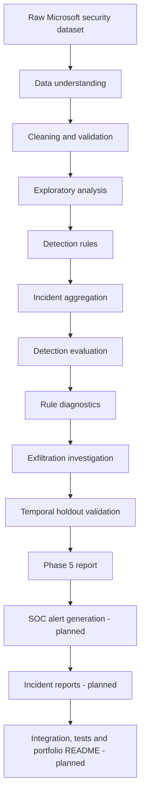
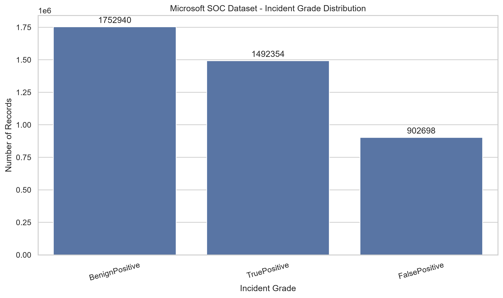
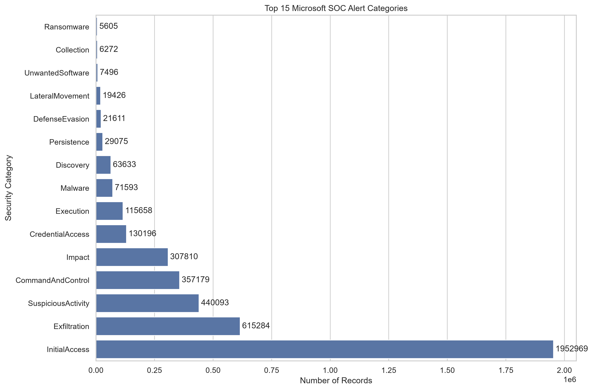
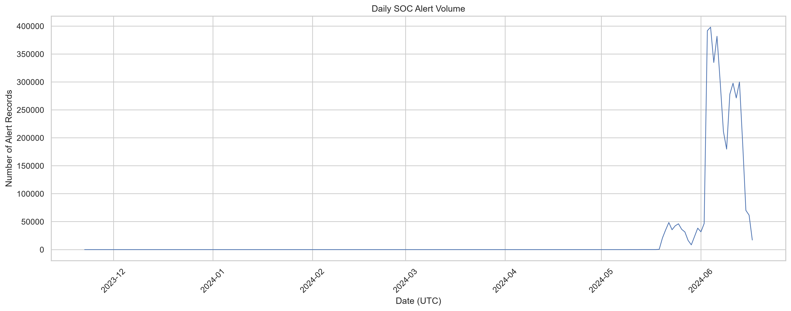
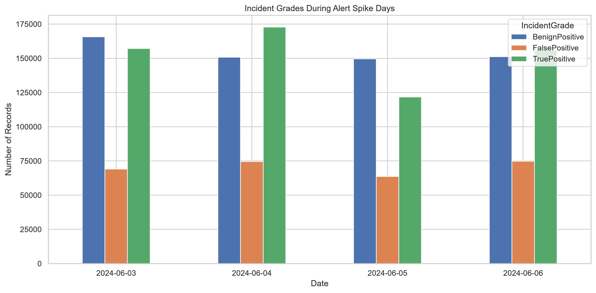
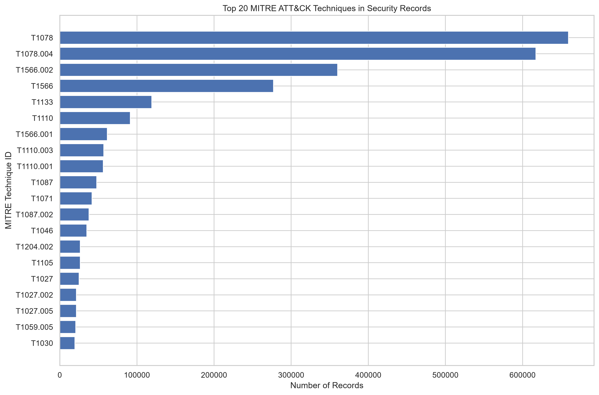
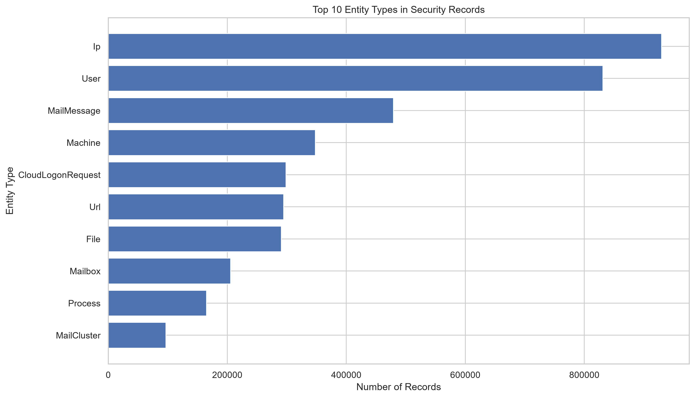
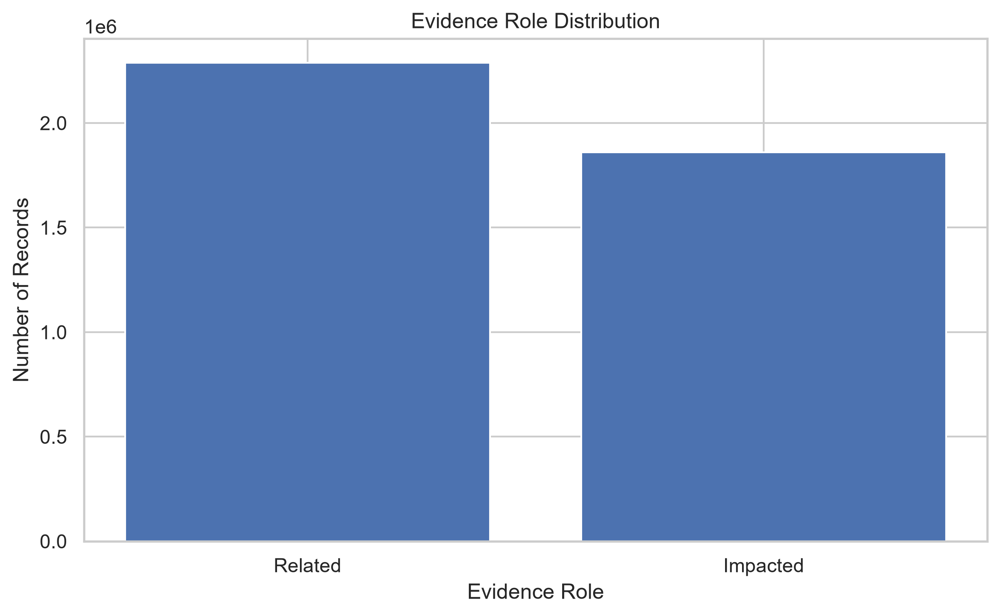

# Microsoft SOC Dataset Project

## Phase 5 --- Threat Detection Engineering & Project File Guide

**[PROJECT Microsoft SOC Dataset]**
**[PHASE 5 IN PROGRESS]**
**[Temporal holdout COMPLETED]**

> **Purpose:** A visual guide to the project architecture, the files
> created so far, what each file does, the important results, and the
> remaining work. The green rounded status badges use the same visual
> style as the supplied example.

------------------------------------------------------------------------

## 1. Project objective

Build an end-to-end security analytics project using the Microsoft
security incident dataset. The workflow demonstrates:

1.  Security data understanding.
2.  Data cleaning and validation.
3.  Exploratory data analysis (EDA).
4.  Rule-based threat detection.
5.  Incident-level aggregation.
6.  Detection evaluation and false-positive analysis.
7.  Focused investigation of suspicious patterns.
8.  SOC alert and incident-report generation.
9.  Reproducible documentation and testing.

**Portfolio positioning:** This is a learning and portfolio project, not
a production SOC platform. Its current rules have not been externally
validated and must not be described as production-ready.

## 2. End-to-end workflow



## 3. Current project structure

``` text
Microsoft-SOC-Project/
│
├── Dataset/
│   ├── raw/
│   │   └── GUIDE_Test.csv
│   ├── processed/
│   │   ├── GUIDE_Test_cleaned_v2.csv
│   │   └── cleaning_report_v2.json
│   └── dataset_parts/
│
├── notebooks/
│   ├── 01_data_understanding.ipynb
│   ├── 02_data_cleaning.ipynb
│   ├── 03_exploratory_analysis.ipynb
│   └── 04_threat_detection.ipynb
│
├── src/
│   ├── data_cleaning.py
│   ├── threat_detection.py
│   ├── validate_detection.py
│   ├── evaluate_detection.py
│   ├── check_label_consistency.py
│   ├── label_quality_report.py
│   ├── detection_metrics.py
│   ├── rule_performance_analysis.py
│   ├── rule_diagnostics.py
│   ├── exfiltration_investigation.py
│   ├── exfiltration_incident_analysis.py
│   ├── exfiltration_alert_title_performance.py
│   └── validate_exfiltration_alert_titles.py
│
├── reports/
│   ├── figures/
│   ├── incident_reports/
│   ├── exfiltration_investigation/
│   ├── Phase_4_EDA_Report.md
│   └── Phase_5_Threat_Detection_Report.md  ← this document
│
└── tests/  (planned)
```

> Status indicators are now plain Markdown text instead of remote badge images. The charts above use local relative image paths. This structure lists files confirmed in the project history. Some
> scripts may be consolidated later. `tests/`, SOC alert generation,
> incident report generation, and a top-level `main.py` are planned, not
> confirmed as implemented.

------------------------------------------------------------------------

# 4. Dataset and quality overview

## 4.1 Dataset profile

  Property                                       Observed value
  ----------------------------------- -------------------------
  Rows                                                4,147,992
  Columns                                                    46
  Earliest timestamp                    2023-11-22 15:55:05 UTC
  Latest timestamp                      2024-06-17 13:30:09 UTC
  Invalid timestamps after cleaning                           0

**[Rows 4.15M]**
**[Columns 46]**
**[Invalid timestamps 0]**

## 4.2 Incident-grade distribution

  IncidentGrade            Records      Share
  ---------------- --------------- ----------
  BenignPositive         1,752,940     42.26%
  TruePositive           1,492,354     35.98%
  FalsePositive            902,698     21.76%
  **Total**          **4,147,992**   **100%**

``` text
BenignPositive  42.26%  █████████████████████
TruePositive    35.98%  ██████████████████
FalsePositive   21.76%  ███████████
```

**Critical distinction:** `IncidentGrade` is an evaluation label. It
must not be used by the detection rules. It is used after detections are
generated to evaluate their performance.

## 4.3 EDA visual gallery

These are embedded local project images, not external image links. Keep the `figures` folder beside this Markdown file (inside `reports/`) so the images render in Markdown preview.

### Incident-grade distribution



### Top security categories



### Daily alert trend



### Peak days by incident grade



### Top MITRE ATT&CK techniques



### Entity types



### Evidence roles



## 4.3 Data-quality cautions

-   Several columns are extremely sparse. Do not remove them without
    understanding their meaning.
-   Numeric-looking fields such as `IpAddress`, `AccountUpn`,
    `CountryCode`, `State`, and `City` are represented as numeric
    identifiers in this dataset. Do not invent IP, email, or geographic
    mappings.
-   `AlertTitle` values are numeric IDs. A verified mapping is needed
    before assigning human-readable names.
-   `ActionGrouped` and `ActionGranular` are approximately 99.95%
    missing.
-   In the Exfiltration subset, only 221 records across 23 incidents had
    a non-null `LastVerdict`.
-   Do not drop repeated IDs without checking their semantics.

------------------------------------------------------------------------

# 5. File-by-file explanation

## 5.1 Dataset files

### `Dataset/raw/GUIDE_Test.csv`

**[RAW DATA Source file]**

**Purpose:** Original dataset input.

**What it contains:** Security telemetry records, including incident
identifiers, timestamps, categories, MITRE techniques, entity
information, and incident labels.

**How it is used:** Input to cleaning and analysis scripts.

**Important:** Preserve this file unchanged. Do not overwrite raw data
with cleaned data.

### `Dataset/processed/GUIDE_Test_cleaned_v2.csv`

**[CLEANED Validated output]**

**Purpose:** Cleaned dataset used by downstream notebooks and scripts.

**What it contains:** 4,147,992 rows and 46 columns.

**Validation:** The output dimensions matched the cleaning report, and
timestamp validation found zero invalid timestamps.

### `Dataset/processed/cleaning_report_v2.json`

**[REPORT Cleaning metadata]**

**Purpose:** Machine-readable record of cleaning and validation results.

**Why it matters:** Makes cleaning results auditable and
programmatically checkable.

------------------------------------------------------------------------

## 5.2 Jupyter notebooks

### `notebooks/01_data_understanding.ipynb`

**[PHASE 1 DATA UNDERSTANDING]**

**Purpose:** Initial dataset familiarization.

**Work performed:** - Load the dataset and inspect its dimensions. -
Review columns and data types. - Inspect sample records. - Understand
missing values and label distribution. - Identify fields that require
careful interpretation.

**Output:** Initial understanding of the dataset structure and
data-quality risks.

### `notebooks/02_data_cleaning.ipynb`

**[PHASE 2 DATA CLEANING]**

**Purpose:** Explore and document the cleaning process.

**Work performed:** - Inspect missing values and data types. - Parse and
validate timestamps. - Apply safe transformations. - Preserve source
fields and record counts. - Export cleaned data and cleaning metadata.

**Output:** Cleaned dataset and cleaning report. The reusable
implementation is `src/data_cleaning.py`.

### `notebooks/03_exploratory_analysis.ipynb`

**[PHASE 4 EDA COMPLETED]**

**Purpose:** Explore security-alert patterns before writing detection
rules.

**Sections:** - Incident-grade distribution. - Top security
categories. - Daily alert trends and high-volume dates. - MITRE ATT&CK
technique frequency. - Entity-type distribution. - Evidence-role
distribution.

**Generated figures:** -
`reports/figures/incident_grade_distribution.png` -
`reports/figures/top_security_categories.png` -
`reports/figures/daily_alert_trend.png` -
`reports/figures/peak_days_incident_grades.png` -
`reports/figures/top_20_mitre_techniques.png` -
`reports/figures/top_10_entity_types.png` -
`reports/figures/evidence_role_distribution.png`

**Interpretation caution:** A spike in records does not prove a
cyberattack. The June 3--6 volume spike included all three incident
grades, so its cause cannot be inferred from volume alone.

### `notebooks/04_threat_detection.ipynb`

**[PHASE 5 THREAT DETECTION]**

**Purpose:** Notebook-based exploration and demonstration of
detection-engineering work.

**Role:** Supports inspection of detection concepts, rule matches, and
outputs. The main reusable detection implementation is
`src/threat_detection.py`.

**Note:** This guide summarizes the notebook's role; inspect the
notebook itself for exact cell-by-cell contents.

------------------------------------------------------------------------

## 5.3 Python source files (`src/`)

### `src/data_cleaning.py`

**[DATA PIPELINE CLEANING]**

**Purpose:** Reusable data-cleaning implementation.

**Responsibilities:** 1. Read source data. 2. Apply cleaning and
timestamp handling. 3. Write the cleaned CSV. 4. Produce cleaning
metadata/report output.

**Why it matters:** Makes cleaning repeatable without manually rerunning
notebook cells.

### `src/threat_detection.py`

**[CORE ENGINE DETECTION]**

**Purpose:** Main rule-based threat-detection engine.

**Responsibilities:** 1. Read cleaned data in chunks of 100,000 rows. 2.
Match records against category-based and MITRE ATT&CK-based rules. 3.
Exclude `IncidentGrade` from detection conditions. 4. Aggregate matched
evidence by `IncidentId`. 5. Calculate a prioritization score. 6. Assign
severity: Critical, High, Medium, or Low. 7. Export incident-level
summaries and JSON reports.

**Known outputs:** -
`reports/incident_reports/incident_detection_summary.csv` - 50 JSON
incident reports

**Scoring interpretation:** RiskScore is a heuristic prioritization
score, not a probability of compromise or a calibrated statistical risk
estimate.

**Known limitation:** Broad category rules can match many benign
records. Exfiltration is a clear example.

### `src/validate_detection.py`

**[VALIDATION STRUCTURAL CHECKS]**

**Purpose:** Check structural integrity of detection output.

**Known checks/results:** - 193,613 incidents in the detection
summary. - No duplicate incident IDs in the validated output. - No
missing incident IDs. - Score distribution inspected.

**Why it matters:** Detection output must be structurally valid before
performance metrics can be trusted.

### `src/evaluate_detection.py`

**[EVALUATION LABEL COMPARISON]**

**Purpose:** Compare generated detections with available incident
labels.

**Role:** Supports evaluation of detected incidents against
`IncidentGrade`.

**Caution:** Labels are not perfectly consistent across all records.
Interpret evaluation results using the label-quality analysis.

### `src/check_label_consistency.py`

**[LABEL QUALITY CONSISTENCY CHECK]**

**Purpose:** Detect incidents that have more than one distinct
`IncidentGrade`.

**Observed result:** - 236,267 unique incidents. - 203,617 incidents
with one consistent label. - 32,650 incidents with conflicting labels. -
13.82% of unique incidents had conflicting labels.

**Why it matters:** Conflicting labels make evaluation ambiguous. They
should not be silently resolved by choosing an arbitrary label.

### `src/label_quality_report.py`

**[LABEL REPORT QUALITY OUTPUT]**

**Purpose:** Separate consistent-label incidents from conflicting-label
incidents.

**Known outputs:** - `consistent_incident_labels.csv` -
`conflicting_incidents.csv`

**Consistent-label distribution:** - BenignPositive: 101,504 -
FalsePositive: 61,012 - TruePositive: 41,101

**Use:** The consistent-label subset supports more interpretable
evaluation, but may not represent every incident.

### `src/detection_metrics.py`

**[METRICS PERFORMANCE EVALUATION]**

**Purpose:** Calculate binary classification metrics for detection
output.

**Evaluation definition:** - Positive class: `TruePositive`. - Negative
class: `BenignPositive` and `FalsePositive`. - A detection is an
incident present in the detection summary.

**Initial observed metrics on 203,617 consistently labelled incidents:**

  Metric                                Result
  ---------------------------------- ---------
  TP                                    26,200
  TN                                    27,182
  Binary FP                            135,334
  FN                                    14,901
  Precision                             16.22%
  Recall                                63.75%
  F1                                    25.86%
  Accuracy                              26.22%
  Detection coverage                    79.33%
  TruePositive baseline prevalence      20.18%

**Interpretation:** Initial precision was below the 20.18% baseline
prevalence. The rules did not enrich the detected population for
`TruePositive` incidents in this evaluation.

**Terminology warning:** Binary FP is not the same as the original
`FalsePositive` label. The binary negative class combines
`BenignPositive` and `FalsePositive`.

### `src/rule_performance_analysis.py`

**[RULE ANALYSIS RULE LEVEL METRICS]**

**Purpose:** Inspect individual rule matches and compare matched
incidents with labels.

**Analysis:** - Count incidents matched by each rule. - Calculate the TP
fraction among matched, consistently labelled incidents. - Compare
detection thresholds. - Identify rules with high match volume but weak
label enrichment.

**Terminology:** Per-rule TP fraction is
`TruePositive incidents / all consistently labelled incidents matched by that rule`.
It is a rule-level precision-like fraction on the evaluated subset. Do
not call it recall or true-positive rate.

### `src/rule_diagnostics.py`

**[DIAGNOSTICS RULE EVIDENCE]**

**Purpose:** Diagnose rule matches using incident labels and supporting
alert fields.

**Known outputs:** - `rule_label_diagnostics.csv` -
`diagnostic_categories.csv` - `diagnostic_techniques.csv` -
`diagnostic_alert_titles.csv` - `diagnostic_entity_types.csv` -
`rule_cooccurrence.csv`

**Analysis sections:** - Rule-level label breakdown. - Category and
MITRE technique distributions. - Alert-title and entity-type
distributions. - Rule co-occurrence patterns.

**Caution:** Co-occurrence does not prove causality or a chronological
attack chain. Missing values must be handled as missing, not converted
into the literal string `nan`.

### `src/exfiltration_investigation.py`

**[INVESTIGATION EXFILTRATION PROFILE]**

**Purpose:** Profile records where `Category == Exfiltration`.

**Observed results:** - 615,284 matching records. - 38,030 unique
incidents. - Main entities: MailMessage, File, User, Machine, and Ip. -
Top MITRE techniques included T1041, T1030, T1537, T1048, and T1567. -
Only 221 records across 23 incidents had a non-null `LastVerdict`.

**Generated outputs:** CSV summaries for alert titles, entity types,
evidence roles, verdicts, incident grades, and MITRE techniques in
`reports/exfiltration_investigation/`.

**Purpose in workflow:** Determine whether a broad category rule can be
refined using more specific evidence.

### `src/exfiltration_incident_analysis.py`

**[LABEL ANALYSIS INCIDENT LEVEL]**

**Purpose:** Check label consistency within the Exfiltration subset and
compare alert-title IDs by incident label.

**Observed results:** - 38,030 Exfiltration incidents. - 37,767
consistently labelled incidents. - 263 conflicting-label incidents. - 0
incidents with missing labels in this subset.

**Generated output:** `exfiltration_alert_titles_by_grade.csv`.

**Why it matters:** Alert-title comparisons should use unique incidents
and consistent labels, not raw row counts.

### `src/exfiltration_alert_title_performance.py`

**[PERFORMANCE ALERT TITLE ANALYSIS]**

**Purpose:** Calculate the incident-level label distribution for each
alert-title ID in the Exfiltration subset.

**Metric:**

`TPFraction = TruePositive incidents / all consistently labelled incidents for that alert title`

**Observed baseline:** 5.88% TruePositive prevalence in the consistently
labelled Exfiltration subset.

**Initial candidate findings:** - AlertTitle 140: 95 TruePositive
incidents, 100% TP fraction. - AlertTitle 304: 50 TruePositive
incidents, 100% TP fraction. - AlertTitle 982: 41 TruePositive
incidents, 100% TP fraction. - AlertTitle 453: 24 TruePositive
incidents, 100% TP fraction. - AlertTitle 1521: 22 TruePositive
incidents, 100% TP fraction. - AlertTitle 3006: 23 TruePositive
incidents, 100% TP fraction. - AlertTitle 65: 32 TP, 4 FP, 98 benign;
23.88% TP fraction. - AlertTitle 105: 23 TP, 26 FP, 47 benign; 23.96% TP
fraction.

**Caution:** These are dataset-specific observations. AlertTitle IDs
have no verified human-readable mapping in the current project context.

### `src/validate_exfiltration_alert_titles.py`

**[TEMPORAL HOLDOUT COMPLETED]**

**Purpose:** Test alert-title candidates on later incidents not used to
select those candidates.

**Method:** 1. Determine a consistent label for each Exfiltration
incident. 2. Use each incident's maximum timestamp to assign a
chronological development or holdout partition. 3. Use the first 80% of
incidents by time as development data. 4. Select candidate alert-title
IDs using development data only. 5. Evaluate those fixed candidates on
later holdout incidents. 6. Compare holdout results against the holdout
baseline.

**Observed result:**

  Metric                                           Result
  ------------------------- -----------------------------
  Development incidents                            30,213
  Holdout incidents                                 7,554
  Development TP baseline                           6.13%
  Holdout TP baseline                               4.85%
  Candidates selected                                   7
  Cutoff                      2024-06-13 01:36:51.200 UTC

**Holdout candidate results:**

    AlertTitle   TP   FP   Benign   Total   TP fraction
  ------------ ---- ---- -------- ------- -------------
            65   10    1       26      37        27.03%
           140   17    0        0      17          100%
           982    7    0        0       7          100%
           105    0    1        1       2            0%

Only four of the seven selected candidates appeared in the holdout. The
other three had no holdout rows and cannot be treated as validated.

**Interpretation:** - AlertTitle 65 is a promising candidate: 27.03% TP
fraction on 37 holdout incidents versus a 4.85% holdout baseline. -
AlertTitle 140 has 17 holdout incidents, all TruePositive. - AlertTitle
982 has only seven holdout incidents, all TruePositive. This sample is
too small for a dependable conclusion. - AlertTitle 105 had two holdout
incidents and no TruePositive incidents.

**Decision:** Keep 65 and 140 as candidates for further validation. Keep
982 as an investigation lead only. Do not promote any candidate directly
into production scoring based on this single experiment.

**Limitations:** This is a temporal holdout within one dataset, not an
external independent test. Candidate selection, alert generation, and
label creation may share dataset-specific dependencies. The holdout does
not establish causal behavior or production performance.

------------------------------------------------------------------------

## 5.4 Reports and generated outputs

### `reports/Phase_4_EDA_Report.md`

**[REPORT PHASE 4 EDA]**

**Purpose:** Document exploratory analysis findings, visualizations, and
data interpretation.

**Includes:** Incident-grade distribution, security-category
distribution, daily alert trends, MITRE ATT&CK analysis, entity types,
evidence roles, and interpretation cautions.

### `reports/figures/`

**Purpose:** Store plots generated by the EDA notebook.

**Known figures:** Grade distribution, top categories, daily trend,
peak-day grade distribution, MITRE techniques, entity types, and
evidence roles.

**Use:** Include relevant figures in the portfolio report and README.
Explain graph axes and data meaning.

### `reports/incident_reports/`

**Purpose:** Store detection outputs.

**Known outputs:** `incident_detection_summary.csv` and 50 JSON incident
reports produced by the detection engine.

**Use:** Demonstrate incident aggregation and structured output. These
files do not prove every generated incident is a real compromise.

### `reports/exfiltration_investigation/`

**Purpose:** Store focused Exfiltration investigation CSVs.

**Known output types:** - Alert-title distribution. - Entity-type
distribution. - Evidence-role distribution. - Verdict distribution. -
Incident-grade distribution. - MITRE technique distribution. - Incident
label quality. - Alert titles by grade. - Alert-title performance. -
Temporal holdout results.

Confirm exact filenames in the folder before linking them elsewhere.

------------------------------------------------------------------------

# 6. Detection engineering: interpreting the results

## 6.1 Rule design

The current engine uses category and MITRE ATT&CK rules. Examples
include:

  Detection rule / signal          Configured score
  ------------------------------ ------------------
  Initial Access Activity                        50
  Credential Access Activity                     80
  Command and Control Activity                   90
  Possible Data Exfiltration                     90
  Impact Activity                                90
  Persistence Activity                           70
  Defense Evasion Activity                       75
  Lateral Movement Activity                      80
  Malware-Related Activity                       85
  Ransomware-Related Activity                   100

The engine combines rule evidence and bonuses for multiple matches or
techniques, then caps the score at 100. Severity bands are Critical
(90+), High (70--89), Medium (50--69), and Low (below 50).

These are project-defined heuristic scores, not calibrated
probabilities.

## 6.2 Initial overall evaluation

``` text
Precision  16.22%  ████████
Recall     63.75%  ████████████████████████████████
F1         25.86%  █████████████
Baseline   20.18%  ██████████
```

Initial detection precision was below the TruePositive prevalence in the
consistent-label evaluation set. The detection output did not enrich for
TruePositive incidents relative to the baseline.

Raising a score threshold alone did not solve the problem. Higher
thresholds reduced recall and did not produce a meaningful precision
improvement in the tested thresholds.

## 6.3 Exfiltration rule diagnosis

The broad Exfiltration category rule matched 30,950 consistently
labelled incidents in the earlier rule diagnostics:

  Label              Matched incidents
  ---------------- -------------------
  TruePositive                   1,965
  FalsePositive                  8,981
  BenignPositive                20,004
  **Total**                 **30,950**

The TP fraction among these matched incidents was 6.35%, below the
20.18% baseline for the full consistent-label evaluation set. The
Exfiltration-specific subset has its own baseline of 5.88%, so
comparisons must use the correct population.

**Key lesson:** A category name alone is not sufficient evidence to
assign high severity. The rule needs more precise, explainable evidence
and further validation.

------------------------------------------------------------------------

# 7. Project status dashboard

  -----------------------------------------------------------------------
  Workstream              Status                  Notes
  ----------------------- ----------------------- -----------------------
  Dataset understanding   Completed               Schema and quality
                                                  inspected

  Data cleaning           Completed               4.15M rows validated

  Exploratory analysis    Completed               Figures and Phase 4
                                                  report created

  Detection engine        Implemented             Rule-based heuristic
                                                  scoring

  Detection structural    Completed               Output integrity
  validation                                      checked

  Label consistency       Completed               Conflicting labels
  analysis                                        identified

  Initial detection       Completed               Precision below
  evaluation                                      baseline

  Rule diagnostics        Completed               Rule-level breakdown
                                                  generated

  Exfiltration            Completed               Category, entity, and
  investigation                                   MITRE profiling

  Alert-title temporal    Completed               Candidate-level holdout
  holdout                                         evaluated

  Phase 5 final           In progress             Code review and final
  review/report                                   checks remain

  SOC alert generation    Planned                 Structured
                                                  analyst-facing alerts

  Incident report         Planned                 Analyst-readable case
  generator                                       reports

  End-to-end pipeline     Planned                 Single repeatable entry
                                                  point

  Automated tests         Planned                 Unit and integration
                                                  tests

  Portfolio README and    Planned                 Setup, screenshots,
  demo                                            findings, limitations
  -----------------------------------------------------------------------

**[Phase 4 Completed]**
**[Temporal holdout Completed]**
**[Phase 5 In progress]**
**[SOC alerting Planned]**

------------------------------------------------------------------------

# 8. Planned next development

## Phase 5 completion checklist

-   [ ] Review final detection rules and confirm `IncidentGrade` is
    never used in detection logic.
-   [ ] Review score calculation and prevent score saturation from
    hiding meaningful differences.
-   [ ] Confirm the evaluation population and document exclusions.
-   [ ] Re-run structural validation and final metrics after any rule
    change.
-   [ ] Record rule limitations and false-positive behavior.
-   [ ] Finalize the Phase 5 report.

## Phase 6 --- SOC alert generation

Planned capability: - Generate a structured alert for each detected
incident. - Include incident ID, severity, score, matched rules,
categories, techniques, timestamps, and evidence references. - Explain
why the alert was generated. - Include recommended analyst investigation
steps. - Do not invent missing entity or threat details.

## Phase 7 --- Incident report generation

Planned capability: - Create a readable incident summary. - Describe
observed evidence. - Separate observed facts from hypotheses. - Include
affected entities and relevant ATT&CK techniques where available. -
Include investigation status and recommended next steps.

## Phase 8 --- Integration and testing

Planned capability: - Add a single entry point such as `main.py`. - Add
tests for rule matching, scoring, aggregation, missing values, and
report generation. - Verify outputs on a small test dataset before
running the full dataset. - Add clear logging and error handling.

## Phase 9 --- Portfolio packaging

Planned capability: - Write a concise root `README.md`. - Add an
architecture diagram and screenshots. - Explain dataset, methodology,
metrics, and limitations. - Provide reproducible setup and run
instructions. - Demonstrate one or two example incidents end to end.

------------------------------------------------------------------------

# 9. How to run the current project

Run commands from the project root in the activated virtual environment.

``` powershell
# Confirm environment
python --version

# Run data cleaning
python src/data_cleaning.py

# Run the detection engine
python src/threat_detection.py

# Validate detection output
python src/validate_detection.py

# Run rule diagnostics
python src/rule_diagnostics.py

# Run Exfiltration investigation
python src/exfiltration_investigation.py
python src/exfiltration_incident_analysis.py
python src/exfiltration_alert_title_performance.py
python src/validate_exfiltration_alert_titles.py
```

> Commands may need adjustment if a script's CLI arguments or paths have
> changed. Run one step at a time and check its output. Avoid rerunning
> expensive full-dataset jobs unnecessarily.

------------------------------------------------------------------------

# 10. Portfolio claims: what is supported

### Supported claims

-   Built a Python-based security analytics workflow using a
    4.15-million-row Microsoft security dataset.
-   Performed data cleaning, validation, and exploratory analysis.
-   Implemented rule-based detection using security categories and MITRE
    ATT&CK technique identifiers.
-   Aggregated detection evidence at incident level.
-   Evaluated detections against consistent incident labels.
-   Investigated label conflicts and rule-level false positives.
-   Conducted a chronological holdout experiment for Exfiltration
    alert-title candidates.

### Claims to avoid

-   "The system detects attacks with 100% accuracy."
-   "The risk score is the probability of compromise."
-   "The detection engine is production-ready."
-   "The alert-title candidates are proven malicious indicators."
-   "The holdout proves the rules generalize to other organizations."
-   "A MITRE technique appearing in a row proves the technique was
    executed."

Report measured results and always explain the evaluation population.

------------------------------------------------------------------------

# 11. Final takeaway

The strongest part of this project is not the number of detection rules.
It is the full analytical workflow: understanding security telemetry,
building explainable rules, measuring false positives, examining label
quality, and testing candidate signals on later data.

The next priority is to improve detection quality and complete the SOC
analyst workflow with structured alerts, incident reports, tests, and
clear documentation.

**[PRINCIPLE Measure before claiming]**

**Document status:** Working Phase 5 report and file guide. Update
metrics and status whenever the detection engine or evaluation
methodology changes.
